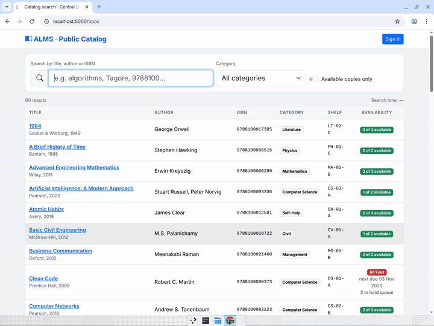

# ALMS — Automated Library Management System

A web app for running a college library: book search, issuing and returning books, holds, overdue fines, reports and admin tools. It uses **Flask + SQLite**, needs no database server, and runs **fully offline** once installed (Bootstrap, icons, Chart.js and JsBarcode are bundled).

## Demo video

[](docs/media/alms-demo.mp4)

*Sped-up preview. Click it, or [open the full 4.5-minute recording](docs/media/alms-demo.mp4), to watch issuing and returning books, the hold queue, time travel and fines, online payment, reports and admin tools.*

## Quick start (WSL / Ubuntu / macOS)

```bash
git clone https://github.com/WitherredAway/alms.git
cd alms
./start.sh
```

The first run creates `.venv/` and installs 3 packages (needs internet once). After that, `./start.sh` starts the server at **http://localhost:5000**. On WSL it also opens the page in your Windows browser.

If Python's venv module is missing (common on a fresh WSL Ubuntu):

```bash
sudo apt update && sudo apt install -y python3 python3-venv
```

Options: `./start.sh --port 8080`, `./start.sh --no-browser`, `./start.sh --reset` (wipe and reload demo data).

## Run with Docker (any Linux server, e.g. a Google Cloud VM)

```bash
git clone https://github.com/WitherredAway/alms.git && cd alms
docker compose up -d --build          # builds the image and starts it in the background
```

The app listens on port **5000**. Data (SQLite DB, secret key, daily backups) lives in the named volume `alms-data`, so it survives restarts and rebuilds.

| Task | Command |
|---|---|
| Use a different host port | `ALMS_PUBLIC_PORT=8080 docker compose up -d` |
| View logs | `docker compose logs -f` |
| Update to latest code | `git pull && docker compose up -d --build` |
| Reset demo data | `docker compose exec alms flask --app alms reset-demo` |
| Copy the DB out (backup) | `docker compose cp alms:/data/alms.db ./alms-backup.db` |
| Stop | `docker compose down` (add `-v` to also delete the data) |

To reach it from the internet on a GCP VM (firewall rule + external IP), see [GUIDE § Deploying with Docker](docs/GUIDE.md#12-deploying-with-docker-google-cloud-vm).

> **Public instance warning:** the demo accounts all use `demo123`, and the sign-in page shows one-click logins. Before sharing a public URL, either limit the firewall to your own IP, or sign in as `ADM001` → *Policies & Settings* → turn off "Show demo account shortcuts" and change the passwords.

## Demo accounts (password `demo123` for all)

The sign-in page has one-click buttons for each account.

| ID | Who | Demo scenario |
|----|-----|---------------|
| `ADM001` | Administrator | Settings, backup/restore, all reports |
| `LIB001` | Librarian | Circulation desk |
| `STU001` | Student | Eligible; has the only copy of *Clean Code*, due in 2 days |
| `STU002` | Student | **Blocked**: book overdue by 6 days (₹30 and growing) |
| `STU003` | Student | **Blocked**: unpaid fine of ₹45 |
| `STU004` | Student | **Blocked**: quota reached (3/3) |
| `STU005` | Student | A hold is ready to collect; also queued for *Clean Code* |
| `FAC001` | Faculty | Higher borrowing quota (5) |

## Suggested live-demo script (about 5 minutes)

1. **Search (FR-03):** open *OPAC Search* and type `tagore` or an ISBN. Results update as you type, with available-copy counts.
2. **Blocked issue (FR-04/06):** as `LIB001`, open *Circulation Desk* and type `STU002`. The profile panel shows **Blocked** with the overdue fine. Try issuing `BC100041` and see the refusal message.
3. **Successful issue:** member `STU006`, barcode `BC100041` → **Issue**. A printable date slip appears (due in 14 days), and Email/SMS confirmations show up under *Notification Gateway*.
4. **Return to the hold queue (FR-05):** on the *Return* tab, return `BC100001` (*Clean Code*). The system puts it on the hold shelf for `STU005` (first in the queue) and notifies them.
5. **Time travel and fines:** click the date button at top right and choose **+15d**. Loans become overdue, fines start growing and overdue notices go out. Return one of them to see the fine charged, then **Collect cash** for a printable receipt. Click **Reset** to go back.
6. **Student view:** sign in as `STU003` → *Pay Fines* → UPI `rohan@okaxis` → receipt. The account becomes eligible again.
7. **Reports (FR-07):** charts, CSV export, and *Print / Save as PDF* for active loans, overdue, frequency, lost books, fines and members with dues.
8. **Admin:** *Policies & Settings* (fine per day, loan period, quotas), *Audit Log*, *Backup & Restore*, and **Reset demo data**.

## How the booklet maps to the code

| Requirement | Where |
|---|---|
| FR-01 Auth & RBAC (Student/Faculty, Librarian, Admin) | `alms/auth.py`: bcrypt hashes, `roles_required`, CSRF tokens |
| FR-02 Catalog CRUD, barcodes | `alms/views/catalog.py` |
| FR-03 OPAC multi-filter search | `alms/views/main.py` (`opac`, `search_books`), indexed columns |
| FR-04 Issue (14-day due) / return | `alms/services.py` `issue_book`, `return_book` |
| FR-05 Hold queue + notify on return | `place_hold`, `_assign_copy_to_next_hold`, hold expiry in `daily_sweep` |
| FR-06 Fines, block borrowing until cleared | `member_status`, `pay_fines`, `waive_fine`, `mark_lost` |
| FR-07 Reports & audit | `alms/views/reports.py`, `audit_log` table |
| Email/SMS gateway (context diagram) | Simulated outbox in the `notifications` table → *Notification Gateway* page |
| NFR-02 Security | bcrypt (salted), CSRF on every POST, HttpOnly session cookies |
| NFR-03 Daily backups | Automatic daily snapshot (last 7 kept) + manual backup/restore |
| NFR-04 Usability | Responsive Bootstrap 5, labelled form fields, skip link, keyboard/scanner-friendly desk |

For a deep dive into the architecture, code walkthrough, and how to build a system like this, see **[docs/GUIDE.md](docs/GUIDE.md)**.

Data lives in `instance/alms.db`. Set `ALMS_DATA_DIR` to store it somewhere else.

## Development

```bash
.venv/bin/pip install pytest
.venv/bin/pytest -q          # business-rule and web tests
.venv/bin/python run.py --debug
```
