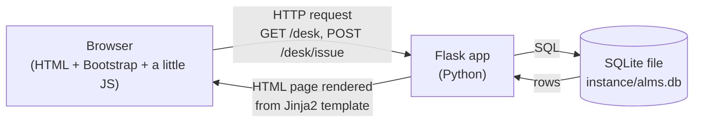
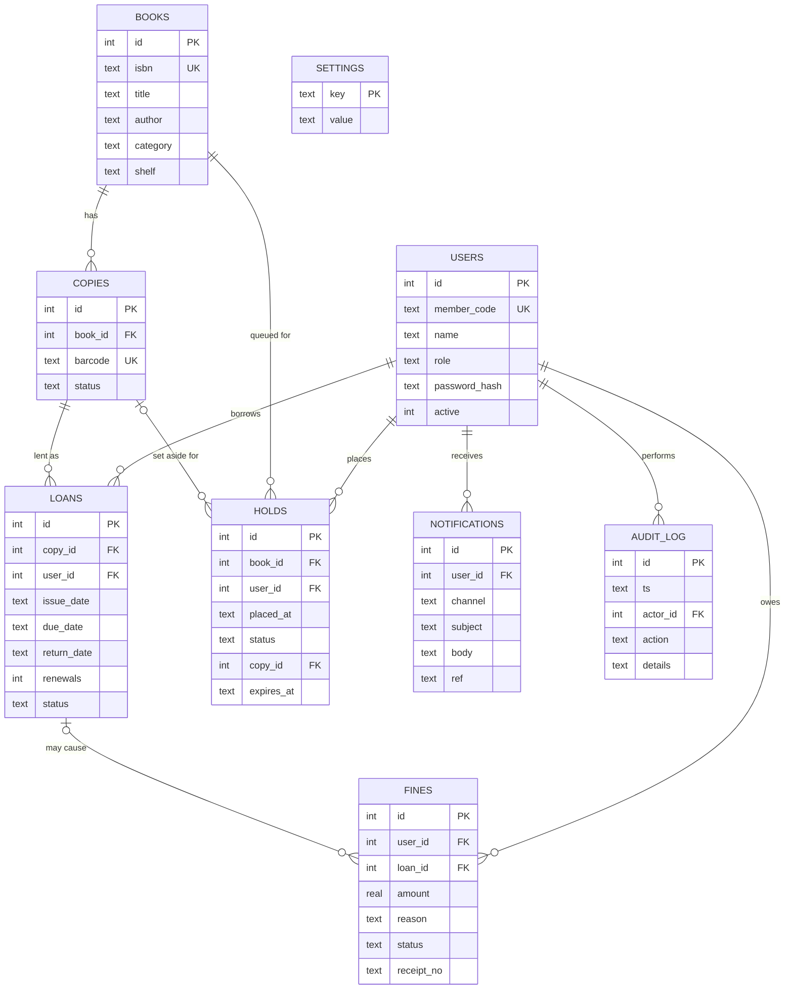
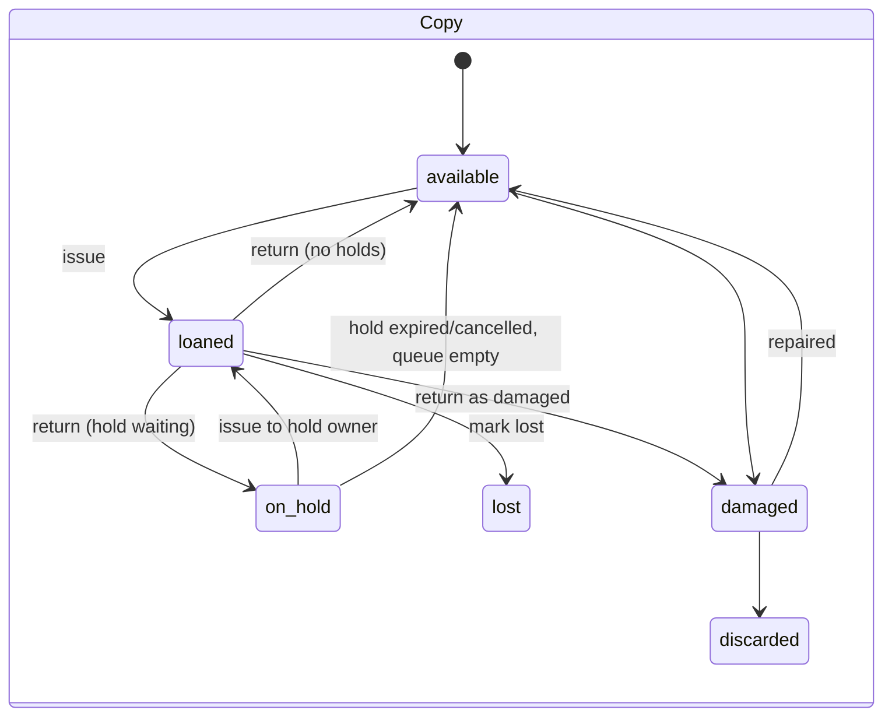
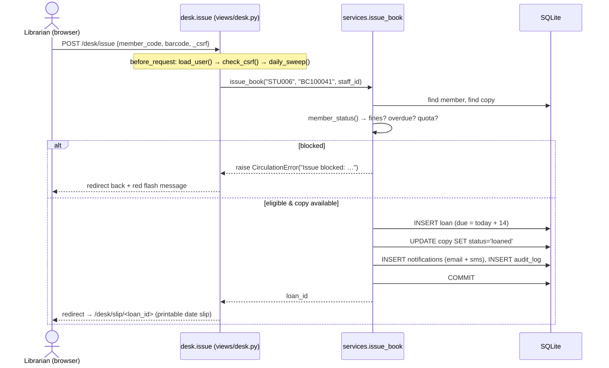

# ALMS — How It Works & How to Build One

This guide explains how ALMS works inside, how the project booklet's diagrams turn into code, and how to build a similar app from scratch. For setup and the demo script, see the [README](../README.md).

- [1. The big picture](#1-the-big-picture)
- [2. Folder & file tour](#2-folder--file-tour)
- [3. The database](#3-the-database)
- [4. Life of a request: "Issue book"](#4-life-of-a-request-issue-book)
- [5. How each feature works](#5-how-each-feature-works)
- [6. Booklet diagrams → code](#6-booklet-diagrams--code)
- [7. Security](#7-security)
- [8. Testing](#8-testing)
- [9. Build one yourself: step-by-step](#9-build-one-yourself-step-by-step)
- [10. Viva / interview questions](#10-viva--interview-questions)
- [11. Ideas to extend it](#11-ideas-to-extend-it)

---

## 1. The big picture

ALMS is a classic **server-rendered web app**:



| Layer | Technology | Why this choice |
|---|---|---|
| Web framework | **Flask** (Python) | Small and easy to read; one file per module, no magic. |
| Templates | **Jinja2** (built into Flask) | The server fills HTML templates with data, so the frontend needs no build step. |
| Database | **SQLite** (Python's built-in `sqlite3`) | The whole database is one file. There's no server to install, which is ideal for a laptop demo. |
| Styling | **Bootstrap 5** + Bootstrap Icons | Responsive, accessible components without writing much CSS. |
| Charts / barcodes | **Chart.js**, **JsBarcode** | Draw the dashboard charts and Code-128 barcodes in the browser. |
| Passwords | **bcrypt** | Industry-standard salted, slow hashing. |
| Server | **waitress** | A production WSGI server in pure Python, which is more robust than Flask's dev server. |

All frontend libraries are copied into `alms/static/vendor/`, so the app works with **no internet**.

### The three layers inside the Python code

```
views/   ->  "controllers": read the HTTP request, call a service, pick a template
services.py -> "business rules": issue, return, fines, holds (no HTML here)
db.py    ->  "data access": connection, schema, settings, today()
```

Keeping the rules in `services.py`, away from the web code, means:
- the same `renew_loan()` function serves both the librarian's desk and the student portal;
- tests can call the rules directly without a browser.

---

## 2. Folder & file tour

```
alms/
├── start.sh            # one-command launcher: creates .venv, installs deps, runs run.py
├── run.py              # starts the waitress server, opens the browser (WSL-aware)
├── requirements.txt    # Flask, bcrypt, waitress (pinned versions)
├── alms/
│   ├── __init__.py     # create_app(): config, blueprints, before_request hooks, filters
│   ├── db.py           # SQL schema, get_db(), settings helpers, today() (simulated date)
│   ├── services.py     # ALL circulation rules: issue/return/renew/lost/holds/fines/notify/audit
│   ├── auth.py         # login/logout/profile, bcrypt, @roles_required, CSRF
│   ├── backup.py       # daily automatic backup, manual backup, restore
│   ├── seed.py         # demo dataset (60 books, 17 users, loans/fines/holds relative to today)
│   ├── views/          # one Flask Blueprint per module (URL prefix in brackets)
│   │   ├── main.py     # dashboard, OPAC search, book page, notifications, receipts, time travel
│   │   ├── catalog.py  # [/catalog] add/edit/delete books, add copies, copy status, labels
│   │   ├── desk.py     # [/desk] circulation desk: issue, return, renew, lost, holds, fines
│   │   ├── member.py   # [/me] student/faculty portal: loans, holds, online payment, ID card
│   │   ├── admin.py    # members, settings, audit log, backup/restore, reset demo
│   │   └── reports.py  # [/reports] 7 report tabs, CSV export
│   ├── templates/      # Jinja2 HTML; base.html is the layout every page extends
│   └── static/         # app.css, app.js, vendor/ (Bootstrap, Chart.js, JsBarcode)
└── tests/              # pytest: rule tests + web tests
```

**Blueprints** are Flask's way of splitting an app into modules. Each one is a group of routes, and `create_app()` registers them all:

```python
bp = Blueprint("desk", __name__, url_prefix="/desk")

@bp.route("/issue", methods=["POST"])
@staff_required
def issue(): ...
```

In templates you link to `url_for("desk.issue")` instead of hard-coding `/desk/issue`.

---

## 3. The database

Nine tables. The key design idea is that a **book (title)** is separate from its **copies (physical items)**: one ISBN can have five copies, each with its own barcode and status.



### Status values (state machines)



- **Loan:** `active` → `returned` or `lost`.
- **Hold:** `waiting` → `ready` (a copy is set aside) → `fulfilled` (issued), or `cancelled` / `expired`.
- **Fine:** `unpaid` → `paid` (with a receipt number) or `waived`.

### Other design notes

- **Dates are stored as ISO text** (`2026-11-15`). SQLite has no real date type. ISO strings sort correctly, so `due_date < '2026-11-01'` just works.
- **Counts are derived, not stored.** "Copies available" is always `COUNT(*) WHERE status='available'`, so it can never get out of sync.
- **Settings are a key/value table** (`fine_per_day`, `loan_days`, `quota_student`…). Admins can change policy without touching code.
- **Indexes** on title, author, copies.book_id and loans(user_id, status) keep searches fast (NFR-01).

The schema lives in `SCHEMA` in `alms/db.py`. `init_schema()` runs `CREATE TABLE IF NOT EXISTS` on every start, so a fresh laptop gets a database automatically.

---

## 4. Life of a request: "Issue book"

This matches **Figure 5 (sequence diagram)** in the booklet.



Step by step:

1. **The browser sends a form POST.** The form includes a hidden `_csrf` token (see [Security](#7-security)).
2. **`before_request` hooks** in `create_app()` run before every view:
   - `auth.load_user()` reads `session["uid"]` and loads the user into `g.user`.
   - `auth.check_csrf()` rejects POSTs without a valid token.
   - `services.daily_sweep()` runs once per (simulated) day: it expires holds, sends reminders and takes a backup.
3. **Decorators check access.** `@staff_required` redirects to login if nobody is signed in, and returns 403 if the role is wrong.
4. **The view** (`desk.issue`) only reads the form and calls `issue_book()`.
5. **The service** applies the rules. If something is wrong it raises `CirculationError`, which the view turns into a flash message.
6. **The service commits the whole transaction at once,** so a half-done issue can never be saved.
7. **Post/Redirect/Get.** After a successful POST the server redirects to a GET page (the slip). Refreshing the slip page then can't issue the book twice.

---

## 5. How each feature works

### FR-01 Login & role-based access
- `auth.login` looks up the user by `member_code` or email, then checks the password with `bcrypt.checkpw`. On success it stores only `session["uid"]`.
- The session is a **signed cookie**. Flask signs it with `SECRET_KEY`, which is generated once into `instance/secret_key`, so users can't tamper with it.
- Access is enforced by decorators:

  ```python
  staff_required  = roles_required("librarian", "admin")
  admin_required  = roles_required("admin")
  member_required = roles_required("student", "faculty")
  ```
- The sidebar in `base.html` shows different menus depending on `g.user.role`. Hiding links is only for convenience, though: the decorators are what actually protect each page.

### FR-02 Catalog management
- `catalog.new` validates the ISBN (10 or 13 digits, unique), creates the book, then calls `add_copies()`. That function assigns sequential barcodes `BC100001, BC100002…` based on the highest existing barcode.
- Adding copies, or marking a damaged copy available again, calls `allocate_free_copies()`. If people are waiting in the hold queue, the new copy goes straight to them.
- Deleting a title is only allowed if it has no loan history. Otherwise you mark its copies `discarded`, which keeps the reports accurate.

### FR-03 OPAC search
- `main.search_books()` is a single SQL query with `LIKE '%term%'` on title, author, ISBN and publisher, plus `GROUP BY` to count available copies and holds.
- **Live search:** `app.js` listens for typing, waits 180 ms (debounce), then fetches `/opac?q=...&partial=1`. The server returns only the results table (`opac/_results.html`), and JS swaps it into the page. This is the same idea as HTMX: the server renders HTML, and JS only fetches and inserts it.

### FR-04 Circulation (issue / return / renew)
- **Issue:** see section 4.
- **Return:** `return_book()`:
  1. closes the loan and computes `overdue_days × fine_per_day`;
  2. if there's a fine, inserts it into the `fines` table;
  3. if the book is damaged, withdraws the copy; otherwise calls `_assign_copy_to_next_hold()`.
- **Renew:** `renew_loan()` refuses if the loan is overdue, the renewal limit is reached, or someone is waiting for the title. Otherwise it adds `loan_days` to the due date.
- The desk page loads the **member panel** live: as you type a member ID, JS fetches `/desk/member-panel?code=...`. This is the booklet's "Query Member Profile & Active Loans" step.

### FR-05 Holds / reservations
- `place_hold()` only works when **no copies are available**. Otherwise the member should just borrow it.
- The queue is **FIFO**, ordered by `placed_at`. `hold_position()` counts how many waiting holds are ahead of you.
- When a copy comes back, `_assign_copy_to_next_hold()`:
  - sets the first waiting hold to `ready`;
  - sets the copy to `on_hold`;
  - sets `expires_at = today + hold_pickup_days`;
  - notifies the member.
- Only that member can then borrow the copy. `issue_book()` checks this.
- If they don't collect it in time, `daily_sweep()` expires the hold and passes the copy to the next person.

### FR-06 Fines
- **Two kinds of money owed:**
  - *Unpaid fines*: rows in `fines`, created when a late book is returned or a book is marked lost.
  - *Accruing fines*: books that are overdue right now. These are calculated on the fly by `accrued_fine()` and not stored yet, because the amount changes every day.
- `member_status()` adds both up. **Any balance over zero blocks borrowing**, as do an inactive account and a full quota. The list of `reasons` it returns is exactly what the desk panel displays.
- Payment: `pay_fines()` marks fines `paid` and generates `RCPT-YYYYMMDD-NNNN`. It's used for cash at the desk and for the simulated UPI/card payment on the student portal. Staff can also waive a fine (`waive_fine()`); the reason they give is recorded in the audit log.
- **Lost book:** `mark_lost()` charges `lost_book_fee` plus any overdue amount.

### FR-07 Reports & audit
- `reports.build(tab)` runs one SQL query per tab and returns `(headers, rows, chart)`. The same data is used three ways: the HTML table, the CSV export (`?export=csv`, using Python's `csv` module), and the print view.
- **PDF export** is the browser's *Print → Save as PDF*. Print-only CSS (`@media print` in `app.css`) hides the sidebar and fits tables onto landscape A4. This avoids needing a PDF library.
- Every important action calls `audit(action, details, actor_id)`, which writes a row to `audit_log` (shown on the *Audit Log* page).

### Notifications (Email/SMS gateway in the context diagram)
- `notify()` inserts one row per channel (`email`, `sms`) into `notifications`. The *Notification Gateway* page shows these as an outbox.
- The optional `ref` field (e.g. `overdue:<loan_id>:<week>`) prevents sending the same alert twice.
- To send real messages later, you'd only change `notify()`, e.g. to call SMTP or an SMS API. Nothing else needs to change.

### Time travel (demo feature)
- `db.today()` returns `date.today() + date_offset`. **All code uses `today()`, never `date.today()`.**
- So changing one setting moves the whole system forward: due dates, overdue fines, hold expiry and reports all follow.
- This is a simple form of **dependency injection for time**. Real systems do the same thing to test date-based logic.

### Backups (NFR-03)
- `backup.automatic_backup()` runs from `daily_sweep()` and uses SQLite's online backup API (`src.backup(dst)`), which is safe while the app is running. It keeps the 7 most recent.
- Restore first validates that the uploaded file contains all ALMS tables, takes a safety snapshot, then copies the backup over the live database.

---

## 6. Booklet diagrams → code

| Booklet element | Where in code |
|---|---|
| **Fig 1 Context diagram**: Patron, Librarian/Admin, Email/SMS gateway | The roles in `users.role`; the gateway is `services.notify()` plus the `notifications` table |
| **Fig 2 DFD L1**: process 1.0 Authentication | `auth.py` (`login`, `load_user`) |
| process 2.0 Catalog search & inventory | `views/main.py` `search_books`, `views/catalog.py` |
| process 3.0 Circulation | `services.issue_book / return_book / renew_loan` |
| process 4.0 Fine billing & reports | `services.pay_fines / waive_fine`, `views/reports.py` |
| D1 Members DB / D2 Book Catalog / D3 Loans & Fines | Tables `users` / `books`+`copies` / `loans`+`fines`+`holds` |
| **Fig 3 DFD L2**: 3.1 Verify member & quota | `services.member_status()` |
| 3.2 Issue & commit loan (copy −1, loan +14d) | `services.issue_book()` |
| 3.3 Process return & inspection (copy +1) | `services.return_book(condition=...)` |
| 3.4 Compute overdue fines & receipts | `overdue_days()`, `accrued_fine()`, `pay_fines()` → `receipt.html` |
| **Fig 4 Activity diagram**: "Pending fines or quota exceeded?" | `member_status()["eligible"]` / `reasons` |
| "Copies available? copies == 0 → Hold queue" | `place_hold()` (only when `available_copies()==0`) → `hold_receipt.html` |
| "Decrement inventory → due date → loan record → slip → confirmation" | the order of statements in `issue_book()` → `slip.html` |
| **Fig 5 Sequence diagram**: `validateLoanEligibility` | `member_status()` |
| `verifyPatronQuotaAndFines` | the SQL in `member_status()` |
| `alt [pendingFines > 0 OR activeLoans >= 3]` | `CirculationError("Issue blocked: …")` |
| `createLoanRecord(… dueDate = +14d)` | `INSERT INTO loans` in `issue_book()` |
| `sendIssueSuccessNotification` | `notify(..., ref=f"issue:{loan_id}")` |
| **Fig 6.1 Student use cases** | `views/member.py` (+ OPAC, profile) |
| **Fig 6.2 Librarian use cases** | `views/desk.py` |
| **Fig 6.3 Admin use cases** | `views/admin.py`, `views/catalog.py`, `views/reports.py` |

---

## 7. Security

| Threat | Defence in ALMS |
|---|---|
| Stolen database leaks passwords | **bcrypt** hashes with a per-password salt (`hash_password`). The plain password is never stored. |
| Someone edits their cookie to become admin | The session cookie is **signed** with `SECRET_KEY`. It's also `HttpOnly` (JavaScript can't read it) and `SameSite=Lax`. |
| A malicious site submits a form on your behalf (**CSRF**) | Every POST must include `_csrf`, which must match the random token stored in the session (`check_csrf`). |
| Student opens `/admin/settings` directly | The `@admin_required` decorator returns 403, no matter which links are shown. |
| **SQL injection** (`' OR 1=1 --`) | Every query uses `?` placeholders (`db.execute(sql, (value,))`). User input is never pasted into SQL. |
| **XSS** (a book titled `<script>`) | Jinja2 **auto-escapes** every `{{ value }}`. |
| Open redirect via `?next=` | Only relative paths starting with `/` (and not `//`) are followed. |

HTTPS (NFR-02) is normally handled by a reverse proxy such as Nginx or Caddy in front of the app. The app itself doesn't need code changes for it.

---

## 8. Testing

Run all tests:

```bash
.venv/bin/pip install pytest
.venv/bin/pytest -q
```

- `tests/conftest.py` creates a **fresh app with a temporary database** for every test, loaded with the demo data. Tests are independent and can't break your real data.
- `tests/test_circulation.py` calls the rules in `services.py` directly. Example:

  ```python
  def test_late_return_assesses_fine_per_day(db):
      bc = loaned_barcode(db, "STU002", "Digital Design")   # seeded 6 days overdue
      r = return_book(bc, staff(db))
      assert r["overdue_days"] == 6 and r["fine"] == 30      # 6 × ₹5
  ```
- `tests/test_web.py` uses Flask's **test client**, a fake browser. It covers login, role checks, CSRF, issuing at the desk, online payment, CSV export and backup.

---

## 9. Build one yourself: step-by-step

This recipe works for most "management system" projects (library, hostel, inventory, clinic, attendance…).

### Step 0 — Requirements → nouns and verbs
Read the requirements and underline:
- **Nouns → tables:** book, copy, member, loan, fine, hold.
- **Verbs → functions:** issue, return, renew, pay, reserve.
- **Rules → `if` checks:** "block borrowing if fines unpaid", "due in 14 days".
- **Actors → roles:** student, librarian, admin.

### Step 1 — Project skeleton
```bash
mkdir myapp && cd myapp
python3 -m venv .venv && source .venv/bin/activate
pip install flask bcrypt
mkdir -p myapp/templates myapp/static
```
Then write a minimal `myapp/__init__.py`:
```python
from flask import Flask, render_template

def create_app():
    app = Flask(__name__)
    app.config["SECRET_KEY"] = "change-me"

    @app.route("/")
    def home():
        return render_template("home.html")

    return app
```
Run it with `flask --app myapp run --debug`, then open http://localhost:5000.

### Step 2 — Database
1. Write the `CREATE TABLE` statements, starting with users plus your two or three main nouns.
2. Add a `get_db()` helper that opens one connection per request and stores it in `g`.
3. Close the connection with `app.teardown_appcontext`.
4. Set `conn.row_factory = sqlite3.Row` so you can write `row["title"]`.

Copy the pattern from `alms/db.py`.

### Step 3 — Auth
Add, in this order:
1. A `users` table with a `role` column and a `password_hash` column.
2. A login route that checks `bcrypt.checkpw` and sets `session["uid"]`.
3. A `before_request` hook that loads `g.user`.
4. A `login_required` and a `roles_required(*roles)` decorator.

Copy the pattern from `alms/auth.py`.

### Step 4 — Business rules in a service module
Write plain functions that take simple inputs (IDs, codes) and raise a custom exception when a rule fails:
```python
class RuleError(Exception): pass

def issue_book(member_code, barcode, staff_id):
    member = find_member(member_code)
    if member is None:
        raise RuleError("No such member")
    if unpaid_total(member) > 0:
        raise RuleError("Unpaid fines")
    ...
    db.commit()
```
**Test these first** with pytest, before building any HTML.

### Step 5 — Views + templates
For each use case:
1. Make a GET route that shows a form or list, and a POST route that calls the service.
2. On error, `flash()` the message and redirect back. On success, redirect to a result page (Post/Redirect/Get).
3. Create a `base.html` layout with a sidebar, and have every page ``.
4. Use Bootstrap classes for the look.

### Step 6 — Polish that impresses examiners
- **Seed data** that tells stories: a blocked user, an overdue loan, a waiting hold. A demo with an empty database is boring.
- **Dashboard** with counts and one or two Chart.js charts.
- **Reports** with CSV export and print-to-PDF.
- **Audit log:** call one `audit()` helper everywhere.
- **A simulated date** if your rules depend on time.
- **A one-command start script** and a README with demo logins.

### Step 7 — Git hygiene
Make one commit per module ("Add schema", "Add auth", "Add catalog"…). Push to GitHub and open a PR. Reviewers, and future you, can then follow how the project was built.

---

## 10. Viva / interview questions

**Q: Why SQLite instead of MySQL?**
It's a single file with no server, so it's perfect for a demo or a single library branch. It handles many concurrent readers easily. For hundreds of simultaneous librarians you would switch to PostgreSQL or MySQL, which mostly means changing the connection code, because the SQL is standard.

**Q: Why separate `books` and `copies`?**
A title (ISBN) is one record, but a library owns several physical copies. Each copy has its own barcode, status and loan history. Without this split you couldn't tell *which* copy is lost or damaged.

**Q: How is the fine calculated?**
`max(0, today − due_date) × fine_per_day`. While the book is still out, the amount is computed live (`accrued_fine`). When the book is returned, the final amount is stored in the `fines` table.

**Q: How does the hold queue decide who gets the book?**
First in, first out by `placed_at`. On return, the copy is assigned to the oldest waiting hold and that member is notified. If they don't collect it within `hold_pickup_days`, it passes to the next person.

**Q: What stops a student with fines from borrowing?**
`member_status()` adds up unpaid fines and accruing overdue amounts. `issue_book()` raises an error if the total is above 0. This check runs on the server, so it can't be bypassed from the browser.

**Q: How are passwords stored?**
As bcrypt hashes with a random salt. bcrypt is deliberately slow, so guessing passwords by brute force is expensive. Two users with the same password get different hashes.

**Q: What is CSRF and how did you prevent it?**
Cross-site request forgery is when a malicious site tricks your logged-in browser into submitting a form to ALMS. Every form includes a random token stored in your session, and the server rejects any POST without the matching token.

**Q: How do you prevent SQL injection?**
Parameterized queries (`?` placeholders). The database driver sends user input separately from the SQL text, so it can never be run as SQL.

**Q: How does the live search work without reloading the page?**
JavaScript waits for a short pause in typing, then fetches the same search URL with `partial=1`. The server returns just the results table, and JS replaces it on the page.

**Q: How did you test date-based rules like overdue fines?**
All code asks `db.today()` for the date instead of the system clock. Tests and the demo change one offset setting to move time forward.

**Q: How would you send real emails/SMS?**
Replace the body of `services.notify()` with an SMTP call or an SMS provider's API (e.g. MSG91 or Twilio). Ideally you'd do this in a background job queue so the desk isn't slowed down.

**Q: How does this meet NFR-01 (1.5 s search under 500 users)?**
- There are indexes on searched columns and the query is a single statement; the page shows the measured search time.
- At real scale you'd run several waitress/gunicorn workers behind Nginx and move to PostgreSQL with full-text search.

**Q: Is the app accessible (NFR-04)?**
- Every input has a label.
- There's a skip-to-content link, and `aria-live` alerts announce messages.
- The layout is responsive, with Bootstrap's high-contrast components.
- The desk works fully by keyboard or barcode scanner: scanners type the code and press Enter.

---

## 11. Ideas to extend it

- **Real notifications:** SMTP for email, an SMS API, and a background scheduler (APScheduler or cron) for reminders.
- **Webcam barcode scanning** in the browser (e.g. the `BarcodeDetector` API or ZXing-js).
- **Book cover images and metadata** fetched by ISBN from the Open Library API.
- **REST API + mobile app:** expose `services.py` functions as JSON endpoints.
- **Multi-branch libraries:** add a `branch_id` to copies and users.
- **PostgreSQL + Docker** for deployment; HTTPS through Caddy or Nginx.
- **Recommendations:** "members who borrowed X also borrowed Y" using the loans table.
